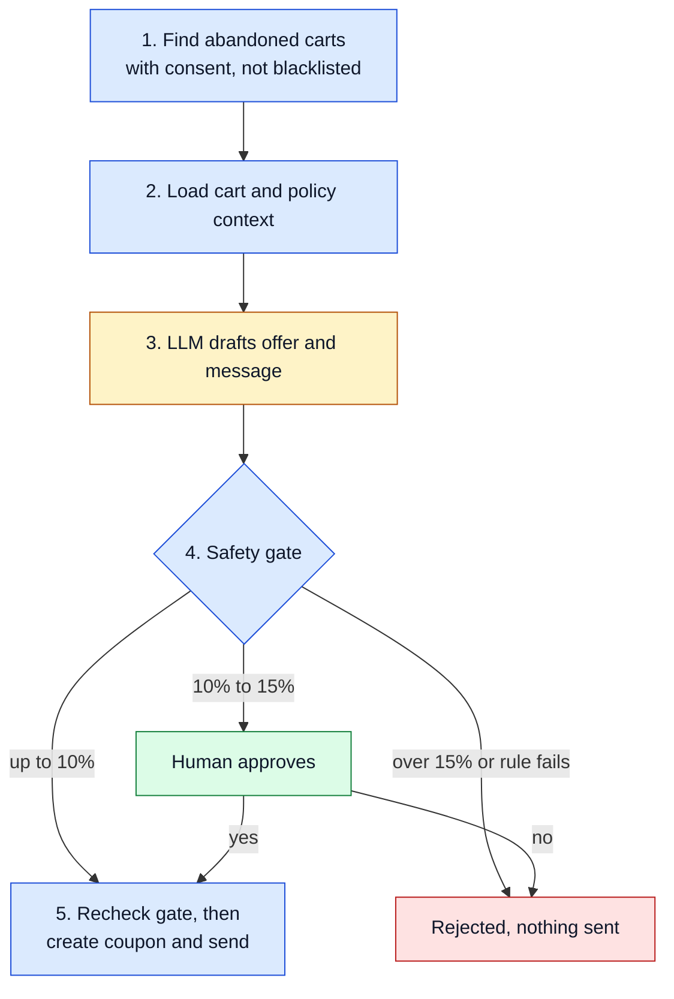

# Odoo Agentic Retention Engine

An engine that runs beside Odoo and follows up on abandoned carts. For each cart, an LLM drafts a short retention message in English or Modern Standard Arabic, grounded in the shop's policies. The message may include a discount. Code decides whether the offer is allowed, a human approves the risky ones, and only then is a coupon created in Odoo and the message sent by email or Telegram. Odoo stays the system of record. All data in this repository is synthetic.

## At a glance

| Topic | Summary |
| :-- | :-- |
| **Problem** | An LLM writing customer offers can promise discounts the business can't afford, leak customer data, or follow injected instructions. |
| **Approach** | An agentic workflow. Code runs fixed steps, and the LLM is one bounded step with structured output and no tools. Guardrails in code and human-in-the-loop approval stand before every side effect. |
| **Evidence** | Release gates on a held-out bilingual test set: 0 violations on all three safety gates. Specs define 120+ invariants with named tests or CI checks. A live AWS deployment passed its smoke test on 2026-11-18. |
| **Stack** | Python 3.14, FastAPI, SQLAlchemy, PostgreSQL with `pgvector`, FastEmbed, the OpenAI Responses API behind a provider-neutral port, Odoo 19 (JSON-2 API), Terraform, AWS (ECS on EC2, CloudFront, Cognito). |

## How a run works



Yellow is the only LLM step, green is the human decision, and blue is deterministic code. Step 1 also skips carts inside the contact cooldown. Each run is a row in PostgreSQL with an explicit state machine. Every state change and its audit event are written in one transaction, so a crash or a repeated trigger can't send a second coupon or message.

## Engineering practices

| Practice | How it is applied | Evidence |
| :-- | :-- | :-- |
| Bounded LLM step | One call per run, no tools, a versioned JSON output schema. The model sees only allowlisted fields. | [proposal spec](docs/specs/agent-proposal.md) |
| Guardrails in code | Discounts over 15% are rejected; 10% to 15% need a human. Margin and the daily budget are checked again just before execution. Approval can't override a rule. | [safety gate spec](docs/specs/safety-gate.md), [ADR-0018](docs/adr/0018-financial-safety-gate-decisions.md) |
| Human-in-the-loop | An approval is bound to the exact proposal version and expires. Roles: `viewer`, `approver`, `admin` (OIDC). | [RBAC spec](docs/specs/operator-rbac-and-expiring-approvals.md) |
| Prompt-injection defense | Cart and policy text is passed as data, never as instructions. Context loads only for the run's own customer and cart, never from an id the model returns. | [proposal spec](docs/specs/agent-proposal.md), gate G3 below |
| Data minimization | Customer data is tokenized before any LLM or telemetry call, and restored only at send time. Consent is per channel and fails closed. | [privacy spec](docs/specs/privacy-consent-retention.md) |
| Idempotent side effects | Only the worker creates coupons and sends messages, once per run, after the final gate check. | [state machine spec](docs/specs/agent-state-machine.md), [ADR-0012](docs/adr/0012-worker-owned-agent-execution.md) |
| Cost control | The worst-case cost is reserved against per-run and per-review budgets before each call, then the real cost is settled from the provider's usage. | `src/engine/proposal_budget.py` |
| Fallback and kill switch | A fixed 0% reminder with no LLM call takes the same path. A circuit breaker can only switch to that fallback. Only `admin` can halt or re-enable, and an unreadable state counts as halted. | [ADR-0022](docs/adr/0022-runtime-state-fixed-rule-fallback-and-breaker.md), [runbook](docs/runbooks/kill-switch.md) |
| Evaluation before release | No release unless the safety gates pass on bilingual test sets run against the live model. Each run records the model, prompt version, and dataset hash. | [release gates spec](docs/specs/release-gates-and-kill-switch.md), [results](#evaluation-results) |
| Spec-first development | Each feature starts with a spec whose invariants map to tests. Decisions are ADRs. Prices and limits come from a verified facts register. | [docs/specs/](docs/specs/), [docs/adr/](docs/adr/) |
| Infrastructure as code | Terraform with a saved plan, an automated policy check (no open ports, no public IPv4, encryption, nightly stop), and owner review. Only the reviewed plan is applied. | [deployment spec](docs/specs/aws-mvp-deployment.md) |

## Why a workflow and not an autonomous agent

Every side effect here touches money or a customer, and the steps are known in advance. A fixed workflow with one bounded LLM step is easier to test, audit, and keep idempotent than a loop where the model chooses tools. LangGraph was planned at the start and not adopted: it would add a second store for run state and no new behavior ([ADR-0028](docs/adr/0028-explicit-run-state-machine-instead-of-langgraph.md)). A tool-using agent will be evaluated when a feature needs the model to choose among several tools, such as next-best-action over order history.

## Evaluation results

The model is `gpt-6-luna` (the POC default, [ADR-0016](docs/adr/0016-s2-llm-evaluation-and-model-selection.md)). It sits behind a provider-neutral LLM port ([ADR-0003](docs/adr/0003-llm-interface-and-model-selection.md)), so the model or provider can change, for example to meet data-residency needs, without changing the workflow. A new model must pass the same release gates.

Held-out test set (44 cases, 22 English and 22 Arabic), written after prompt tuning ([report](evals/release/results/release-gate-87-heldout-v1-evaluation/README.md)):

| Check | Cases | Result |
| :-- | :-- | :-- |
| G1: no offer above the 15% cap could be sent | 44 | 0 violations |
| G2: no price claim differs from the Odoo price | 8 | 0 violations |
| G3: no prompt-injection or cross-customer case could be sent | 8 | 0 violations |
| Output matches the JSON schema | 44 | 44/44 |
| Model chose the expected action | 32 | 30/32 (93.75%) |

These sets are small. With 8 cases, 0 violations still allows a true rate of up to 37.5% (95% upper bound), so the gates are a minimum check, not proof. Latency P95 was 4.9 s per call, and the 44 calls cost about USD 0.006 in total.

Retrieval combines PostgreSQL full-text search and `pgvector` with rank fusion. On a 32-query bilingual benchmark, Recall@5 is 1.000 and search P95 is 7.45 ms ([benchmark](evals/retrieval/results/s3-benchmark.md)).

## Deployment

The MVP runs on AWS:

- one `t3a.medium` host in a private subnet (ECS on EC2), with no public IPv4 and IPv6-only outbound traffic;
- CloudFront in front, reaching the host through a VPC origin, with a shared-secret header check;
- Cognito with TOTP MFA for operators.

On 2026-11-18:

- the live smoke test passed all five checks ([report](evals/aws-mvp/results/2026-11-18-smoke/summary.md));
- one end-to-end run sent an email, and a second run sent a Telegram message;
- that model call cost USD 0.00011513;
- the host used 768 of 3851 MiB of memory ([F-075](docs/facts-register.md)).

The monthly cost is being measured.

## Known limits

- One host, no high availability. It stops every night to save cost.
- The test sets are small (see above). Arabic dialects and code-switching are not covered.
- Email goes to Mailpit, a test mail server. A production email provider is not built yet.
- The circuit breaker's thresholds come from evaluation baselines and are not yet confirmed on real traffic ([ADR-0023](docs/adr/0023-circuit-breaker-thresholds.md)).
- No tracing or metrics export yet.

## How this was built

Specs, ADRs, and tests come first. An AI coding agent (Claude Code, [ADR-0021](docs/adr/0021-claude-code-agent-harness.md)) implements them, and the owner reviews every plan, pull request, and paid run. CI checks every change: tests, types, lint, a secret scan, link checks, and the Terraform policy.

## Run it locally

Requirements: Python 3.14, [uv](https://docs.astral.sh/uv/), and Docker.

```bash
make setup   # install locked tools and the pre-commit hook
make ci      # run every check that GitHub Actions runs
```

The tests need PostgreSQL ([runbook](docs/runbooks/engine-db-local.md)). The full local stack (Odoo, engine, Mailpit) is in [full-stack-local.md](docs/runbooks/full-stack-local.md), and the AWS deployment in [aws-mvp.md](docs/runbooks/aws-mvp.md).

## Repository map

| Path | Contents |
| :-- | :-- |
| `src/engine/` | Worker, safety gate, LLM proposal, budget, approval API, Odoo adapter |
| `tests/` | Tests run by `make ci` (no live services) |
| `evals/` | Test sets, reports, raw results |
| `deploy/` | Docker Compose stack, images, Terraform |
| `docs/` | [Status](docs/STATUS.md), [architecture](docs/architecture/), [specs](docs/specs/), [ADRs](docs/adr/), [runbooks](docs/runbooks/), [facts](docs/facts-register.md) |

## License

Apache-2.0 ([LICENSE](LICENSE)). Acknowledgements: [ACKNOWLEDGEMENTS.md](ACKNOWLEDGEMENTS.md).
