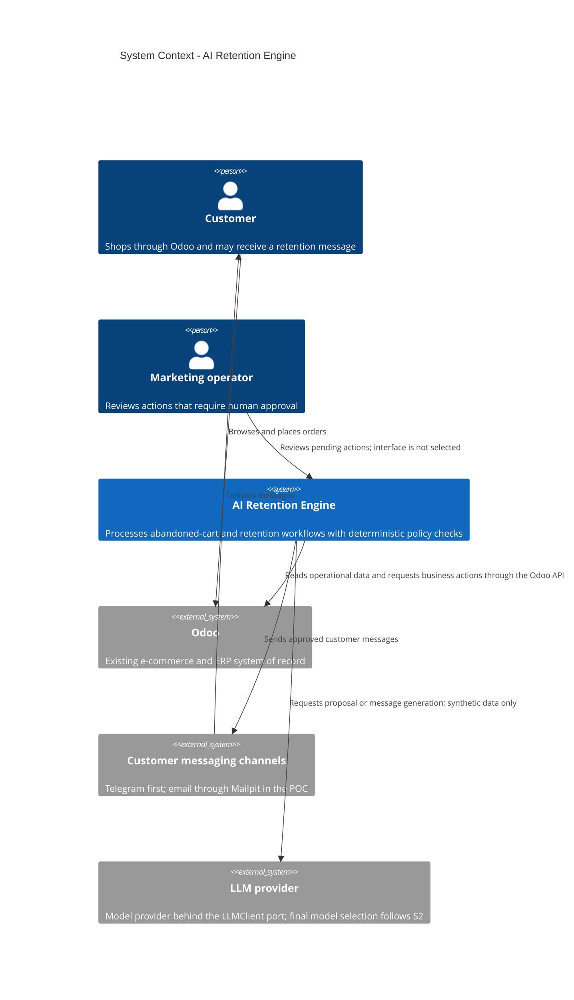
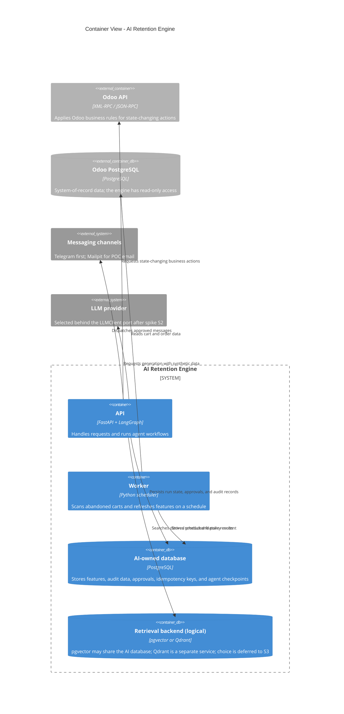
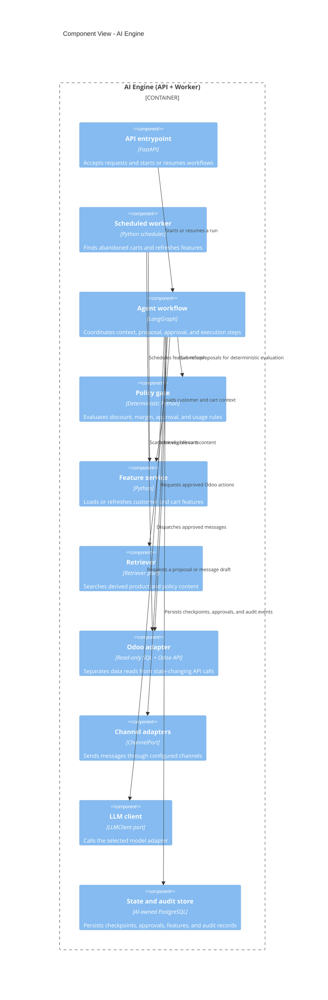

# Architecture overview

This page records the current system context, container view, and AI engine components. The diagrams use Mermaid C4 syntax as selected in [ADR-0010](../adr/0010-c4-diagrams-in-mermaid.md).

## C1: System context

## C2: Containers

## C3: AI engine components

## Scope and decisions still pending

- Odoo is the system of record; the engine reads its database and uses the Odoo API for state changes. The engine's own state and audit data use a separate database ([ADR-0001](../adr/0001-odoo-system-of-record-and-ai-database.md)).
- The API and scheduled worker are entrypoints in one modular monolith ([ADR-0002](../adr/0002-modular-monolith.md)); scheduled jobs replace a streaming platform in running code ([ADR-0004](../adr/0004-batch-over-streaming.md)).
- The vector retrieval backend is not selected. The pgvector and Qdrant candidates remain behind a `Retriever` port until spike S3 ([ADR-0006](../adr/0006-retrieval-store-benchmark.md)).
- The final LLM provider/model follows spike S2 ([ADR-0003](../adr/0003-llm-interface-and-model-selection.md)). Only synthetic data may be sent to cloud services ([ADR-0007](../adr/0007-free-tier-observability.md)).
- The operator interface, connection details, and deployment topology are not specified here; see the remaining architecture extraction issues.
