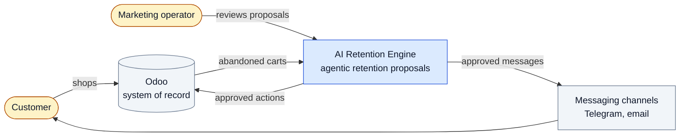
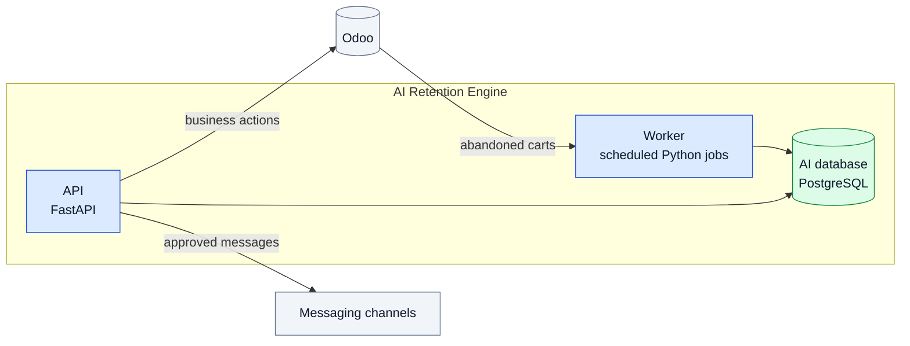
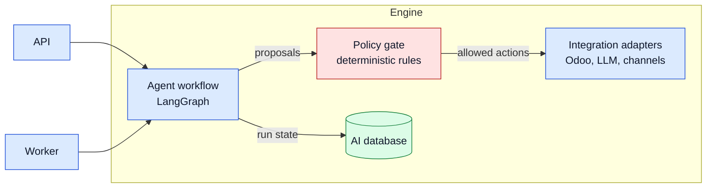

# Architecture overview

Three focused diagrams show the system boundary, runtime containers, and agent execution path. They are Mermaid flowcharts that follow the C4 levels, as selected in [ADR-0011](../adr/0011-flowchart-diagrams-in-mermaid.md).

## C1: System context

The engine reads from Odoo, proposes retention actions, and sends only approved messages. Proposals that need a human are reviewed by a marketing operator.

## C2: Runtime containers

The API handles interactive runs. The worker scans carts and refreshes features on a schedule. Both keep state, approvals, and audit data in the AI database, which is separate from Odoo.

## C3: Components (agent execution path)

The API and the scheduled worker start the same workflow. Every proposal passes the policy gate before an adapter can act, so the LLM never decides money.

## Architecture constraints

- Odoo remains the system of record. The engine reads its database and uses the Odoo API for state changes; AI-owned state is stored separately ([ADR-0001](../adr/0001-odoo-system-of-record-and-ai-database.md)).
- The API and scheduled worker are entrypoints in one modular monolith; scheduled jobs are used instead of a streaming platform in running code ([ADR-0002](../adr/0002-modular-monolith.md), [ADR-0004](../adr/0004-batch-over-streaming.md)).
- The retrieval store is not selected; pgvector and Qdrant remain candidates until spike S3 ([ADR-0006](../adr/0006-retrieval-store-benchmark.md)).
- The final LLM provider/model follows spike S2 ([ADR-0003](../adr/0003-llm-interface-and-model-selection.md)). Only synthetic data may be sent to cloud services ([ADR-0007](../adr/0007-free-tier-observability.md)).
- C3 focuses on the internal workflow and adapter boundary. External systems are shown in C1 and C2 to avoid repeating a dense integration map.
