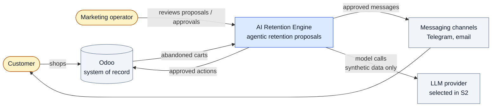
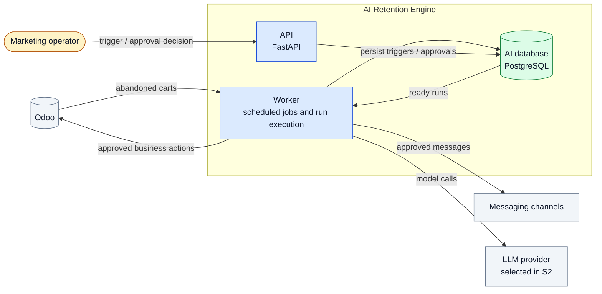
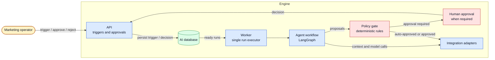

# Architecture overview

Three focused diagrams show the system boundary, runtime containers, and agent execution path. They are Mermaid flowcharts that follow the C4 levels, as selected in [ADR-0011](../adr/0011-flowchart-diagrams-in-mermaid.md).

## C1: System context

The engine reads from Odoo, proposes retention actions, and sends only approved messages. Proposals that need a human are reviewed by a marketing operator.

## C2: Runtime containers

The API durably records inbound triggers and operator decisions. The worker scans carts, processes all runs, and exclusively performs Odoo writes and message dispatch. It uses the separate AI database to claim work and persist run state.

## C3: Components (agent execution path)

The API records triggers and approval decisions. The worker runs every workflow and owns all side effects. The workflow uses adapters for context reads and LLM calls before policy evaluation; only auto-approved or human-approved actions reach adapters for Odoo writes and message dispatch. The external systems are shown in the context and container views.

## Architecture constraints

- Odoo remains the system of record. The engine reads its database and uses the Odoo API for state changes; AI-owned state is stored separately ([ADR-0001](../adr/0001-odoo-system-of-record-and-ai-database.md)).
- The API and scheduled worker are entrypoints in one modular monolith; the worker alone executes workflows and side effects ([ADR-0002](../adr/0002-modular-monolith.md), [ADR-0012](../adr/0012-worker-owned-agent-execution.md)). Scheduled jobs are used instead of a streaming platform ([ADR-0004](../adr/0004-batch-over-streaming.md)).
- The retrieval store is not selected; pgvector and Qdrant remain candidates until spike S3 ([ADR-0006](../adr/0006-retrieval-store-benchmark.md)).
- The final LLM provider/model follows spike S2 ([ADR-0003](../adr/0003-llm-interface-and-model-selection.md)). Only synthetic data may be sent to cloud services ([ADR-0007](../adr/0007-free-tier-observability.md)).
- C3 focuses on the internal workflow and adapter boundary. External systems are shown in C1 and C2 to avoid repeating a dense integration map.
