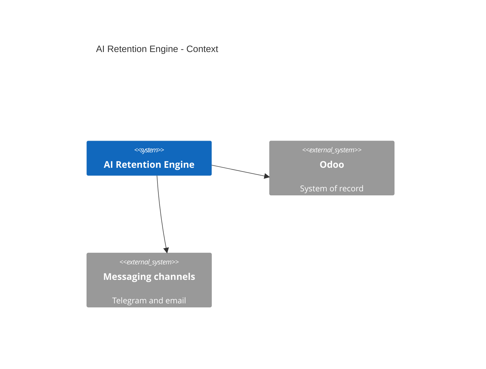
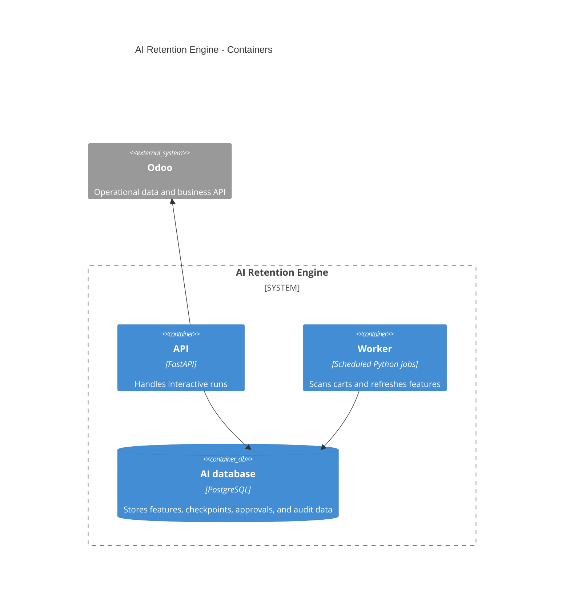
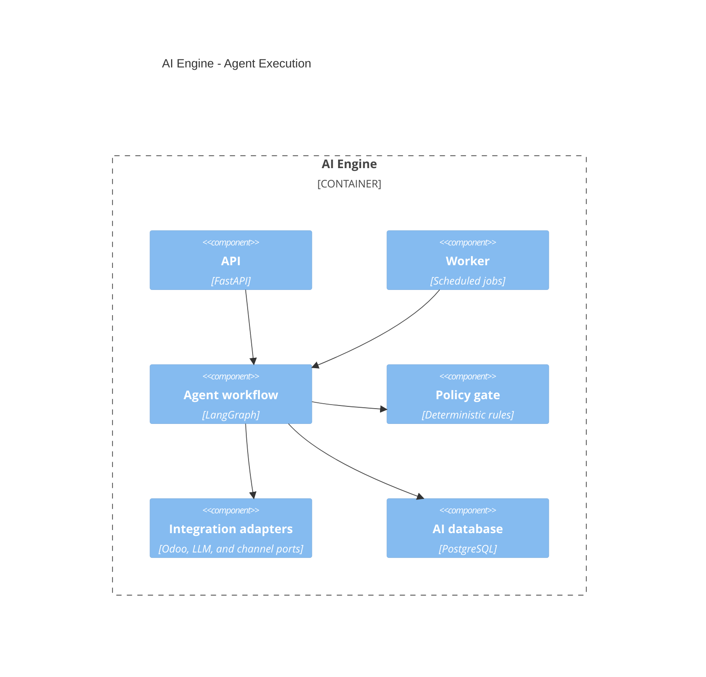

# Architecture overview

Three focused diagrams show the system boundary, runtime containers, and agent execution path. Mermaid C4 is used as selected in [ADR-0010](../adr/0010-c4-diagrams-in-mermaid.md).

## C1: System context

Customers use Odoo and receive approved messages through the channels. Marketing operators review proposals that require human approval.

## C2: Runtime containers

The Odoo relationship represents the engine's integration boundary: the API requests business actions, and the worker reads abandoned carts. The API and worker persist state and features in the AI database. Approved messages use the channel boundary shown in C1.

## C3: Agent execution path

This view focuses on one request path. The scheduled worker and retrieval options are shown in C2.

The API and scheduled worker start the same agent workflow. It evaluates proposals through the policy gate, uses integration adapters, and persists run state.

## Architecture constraints

- Odoo remains the system of record. The engine reads its database and uses the Odoo API for state changes; AI-owned state is stored separately ([ADR-0001](../adr/0001-odoo-system-of-record-and-ai-database.md)).
- The API and scheduled worker are entrypoints in one modular monolith; scheduled jobs are used instead of a streaming platform in running code ([ADR-0002](../adr/0002-modular-monolith.md), [ADR-0004](../adr/0004-batch-over-streaming.md)).
- The retrieval store is not selected; pgvector and Qdrant remain candidates until spike S3 ([ADR-0006](../adr/0006-retrieval-store-benchmark.md)).
- The final LLM provider/model follows spike S2 ([ADR-0003](../adr/0003-llm-interface-and-model-selection.md)). Only synthetic data may be sent to cloud services ([ADR-0007](../adr/0007-free-tier-observability.md)).
- C3 focuses on the internal workflow and adapter boundary. External systems are shown in C1 and C2 to avoid repeating a dense integration map.
